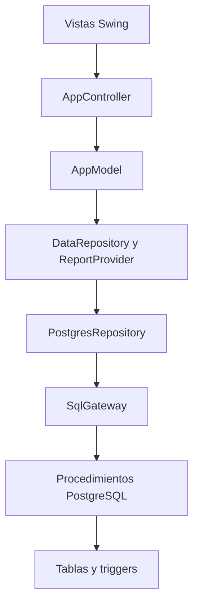

# Memoria descriptiva — NotaSys 1.0

## Propósito

NotaSys centraliza el registro y consulta de facturas, boletas y notas de crédito/débito del proyecto M&Zuel. Ofrece una interfaz de escritorio para consumir la base de datos desarrollada en la entrega 4 y demostrar operaciones de inserción, modificación, desactivación lógica y consulta mediante procedimientos.

## Diseño y arquitectura

La arquitectura utiliza Modelo–Vista–Controlador. Las vistas Swing recogen entradas y presentan documentos; el controlador coordina eventos, tareas y actualización de pantallas; el servicio de aplicación valida reglas antes de solicitar persistencia. PostgreSQL mantiene las relaciones, transacciones, restricciones y auditoría.

La composición ocurre en `App`. El cliente nativo psql/libpq se incluye en la distribución y se ejecuta sin shell. Los reportes utilizan paginación en PostgreSQL y ventanas independientes. Las tareas de conexión, guardado de documentos, consultas y exportación utilizan SwingWorker.

## Herramientas

Java 17 como nivel de compilación, JDK 21 para compilar y empaquetar, Swing, PostgreSQL, cliente nativo psql/libpq, PowerShell para construcción, jpackage para distribución y pruebas Java sin frameworks. El código queda preparado para su publicación en el repositorio GitHub del equipo; no se ha publicado un repositorio desde esta sesión.

## Justificación conceptual

La aplicación conecta la integridad relacional con una operación guiada. La nota se origina en un comprobante y solo admite sus artículos. Separar la presentación, las reglas y la persistencia facilita corregir la interfaz sin modificar la estructura de datos. Conservar el historial y usar borrado lógico permite revisar operaciones previas.

## Aplicación de SOLID

| Principio | Aplicación concreta |
|---|---|
| Responsabilidad única | Vistas para presentación, controlador para coordinación, AppModel para reglas, repositorio para mapeo SQL, transporte para ejecución y DocumentPreview para representación documental. |
| Abierto/cerrado | Un transporte alternativo puede implementar SqlGateway sin modificar el repositorio; otro almacenamiento implementa DataRepository. |
| Sustitución de Liskov | El repositorio de pruebas cumple los contratos de carga y guardado; ante un error, no confirma cambios. La aplicación depende del contrato, no del almacenamiento específico. |
| Segregación de interfaces | DataRepository y ReportProvider separan persistencia y consultas; SqlGateway expone únicamente la ejecución necesaria para el adaptador. |
| Inversión de dependencias | AppModel recibe interfaces por constructor; App crea e inyecta las implementaciones concretas. |

## Estructura y módulos

Catálogos administra emisores, clientes y servicios. Comprobantes administra facturas y boletas. Notas de ajuste valida y registra créditos/débitos vinculados. Reportes ofrece las 18 consultas originales agrupadas en 15 opciones. Historial presenta auditoría persistente. Configuración y Ayuda explican conexión, operación y límites del sistema.

La estructura conserva las once tablas originales y agrega estado activo, versión para concurrencia, descripción histórica en detalles y la tabla de historial. Las claves documentales incluyen emisor, serie y correlativo para permitir numeraciones coincidentes entre empresas. La importación copia desde `public` a `notasys` sin alterar los originales.

## Normas utilizadas

- Código UTF-8 e indentación de cuatro espacios en Java.
- Clases en PascalCase; métodos y variables en camelCase.
- Importes en BigDecimal y NUMERIC; redondeo explícito a dos decimales.
- Claves foráneas, restricciones CHECK, transacciones y validación de versión.
- Contraseñas excluidas de archivos de preferencias.
- Valores SQL escapados; ejecución de procesos sin intérprete de comandos.
- Escape HTML y neutralización de fórmulas en CSV.
- Pruebas reproducibles con datos aislados; no alteración del esquema original.

## Objetivos

1. Facilitar el registro y mantenimiento de comprobantes y notas.
2. Evitar notas con artículos ajenos, créditos excesivos y devoluciones duplicadas.
3. Consultar la información mediante reportes parametrizados y exportables.
4. Preservar trazabilidad y demostrar el uso directo de PostgreSQL sin ORM.

## Alternativas

Una alternativa es operar directamente desde pgAdmin con scripts SQL; otra consiste en utilizar hojas de cálculo controladas para registrar ajustes y preparar consultas manualmente. NotaSys agrega formularios, validaciones y navegación sobre la base relacional del proyecto.

## Justificación económica

La comparación debe considerar desarrollo, capacitación, mantenimiento y corrección de errores. pgAdmin reduce el esfuerzo inicial de programación, pero demanda conocimiento SQL para cada operación. Las hojas de cálculo tienen un costo inicial reducido cuando ya están disponibles, aunque requieren conciliaciones y controles manuales. NotaSys exige desarrollo inicial y mantenimiento, a cambio de repetir las operaciones mediante formularios y procedimientos reutilizables. No se atribuyen ahorros monetarios medidos porque no se cuenta con tiempos ni tarifas reales de la empresa.

## Justificación práctica

La interfaz evita que el usuario tenga que escribir SQL para tareas habituales. La selección de artículos desde el comprobante, el control de saldos y el historial reducen inconsistencias observables. Las ventanas independientes y la paginación permiten revisar varias consultas. El ejecutable incluye Java y facilita abrir el cliente en Windows; PostgreSQL sigue siendo un recurso externo necesario.

## Límites y validación

Es un sistema de gestión interna, sin emisión electrónica ni integración SUNAT. Los comprobantes nuevos usan IGV del 18 % y el tratamiento de ajustes cubre los motivos incluidos en el formulario. Los registros ampliados son sintéticos para evaluación, no operaciones reales. El detalle de pruebas y las limitaciones de la verificación se encuentran en `Verificacion.md`.

## Anexo: repositorio

Pendiente de completar por el equipo con la URL de su repositorio GitHub. No se inventa un enlace ni se declara una publicación que no se realizó.

Este texto es una versión editable breve; al trasladarlo al formato institucional, verifica que la memoria no exceda ocho páginas, incluido el anexo según el criterio de tu docente.
